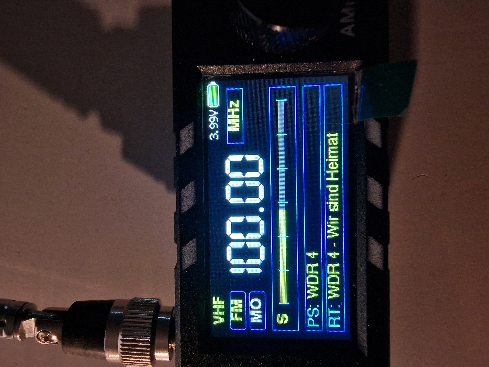

# ATS Mini V4 – 13HN2709 Firmware

  

  <strong>Custom firmware and interface development for the ATS Mini V4 (SI4732 / ESP32-S3)</strong> 
  By <a href="https://github.com/13HN2709">13HN2709</a> · Callsign: 13HN2709

  <strong>🌐 Language / Sprache / Lingua</strong> 
  <a href="README.md">🇬🇧 English</a> · <a href="README_DE.md">🇩🇪 Deutsch</a> · <a href="README_IT.md">🇮🇹 Italiano</a>

This repository contains my development fork of the ATS Mini firmware for the SI4732-based ATS Mini V4 receiver. The project combines the upstream receiver firmware with custom display layouts, usability improvements and web-control features.

## Downloads

**Firmware releases for this fork:**  
➡️ **[Open 13HN2709 Releases](https://github.com/13HN2709/ats-mini/releases)**

The Releases page contains the published firmware packages. Choose the package that matches your device's flash configuration (OSPI or QSPI) and language (DE or EN). OTA files are intended for supported over-the-air update workflows; ZIP packages contain the corresponding release package/source files as provided by the build.

**Latest published release currently listed:** [v1.22](https://github.com/13HN2709/ats-mini/releases/tag/v1.22). Check the release notes and available files before installing. Newer development features may not yet be part of a published release.

## Project highlights

- **Multiple receiver display layouts**, including Clean and TEF6686-inspired designs.
- **Frequency keypad and tuning improvements** for more direct frequency entry.
- **Bandplan assistance** in supported layouts to help identify common operating activities and modes.
- **Integrated local web control** designed to work on the receiver's own network without requiring internet access.
- **Spectrum scan tools** and receiver-control enhancements, depending on the published firmware version.
- **German and English interface support** in supported menus and controls.

Features can vary between releases. Refer to the release notes for the exact changes included in each build.

## Custom features by 13HN2709

The following additions and interface changes are part of my own development work on this fork, beyond the original upstream project. Exact availability can depend on the firmware release:

- **Frequency Keypad** — enter a target frequency directly instead of tuning only with the encoder.
- **VFO A/B transfer and handling** — transfer or switch frequencies between VFO A and VFO B where supported by the build.
- **Web Frequency Step control** — change the tuning step directly in the local Web Control Center.
- **German / English interface** — bilingual menu and control labels, with localized descriptions for important settings.
- **Integrated BFO control** — fine frequency adjustment for reception modes that use a beat-frequency oscillator, particularly SSB.
- **Expanded Spectrum Scanner** — scan a selected frequency range with mode/step options, select a detected peak to tune the receiver, and use memory-related actions where available.
- **Web-based memory controls** — view and select saved memories and use memory-saving workflows in supported builds.
- **Standalone local Web Control Center** — receiver controls designed to run on the device's local network without needing an internet connection.
- **Custom display layouts** — including a separate Clean Layout for development/testing and a TEF6686-inspired visual design.
- **Bandplan Assistant** — frequency-based operating hints in supported layouts, using concise English on-screen labels.
- **Dual RX and receiver UI refinements** — additional scan/control behavior and display adjustments included in applicable builds.

These are fork-specific additions, not a claim that every feature is present in every published release. Check the selected release's notes and assets for the exact feature set.

## Development status

- `main` is the stable release branch.
- `development` is used for ongoing development and testing.
- Temporary feature branches are removed after their tested changes have been promoted.

## Documentation

For general ATS Mini hardware information and upstream documentation, see the [ATS Mini documentation](https://esp32-si4732.github.io/ats-mini/).

## Credits and upstream projects

This firmware is based on the ATS Mini / SI4732 receiver ecosystem and builds on work by the original project maintainers and open-source contributors. Thank you to the developers whose work makes this project possible.

Related projects and libraries include:

- [ATS Mini upstream project](https://github.com/esp32-si4732/ats-mini)
- [Max Arnold – ATS Mini firmware work](https://github.com/G8PTN/ATS_MINI)
- [PU2CLR SI4735 library](https://github.com/pu2clr/SI4735)
- [Volos Projects – TEmbedFMRadio](https://github.com/VolosR/TEmbedFMRadio)
- [Ralph Xavier – SI4735](https://github.com/ralphxavier/SI4735)
- [Goshante – ATS20/ATS-EX](https://github.com/goshante/ats20_ats_ex)

This repository is a community firmware fork. Please retain the original licenses and attributions applicable to upstream code and third-party libraries.

## Contact and project

- **Maintainer:** [13HN2709 on GitHub](https://github.com/13HN2709)
- **Firmware releases:** [13HN2709/ats-mini/releases](https://github.com/13HN2709/ats-mini/releases)
- **Source code:** [13HN2709/ats-mini](https://github.com/13HN2709/ats-mini)
